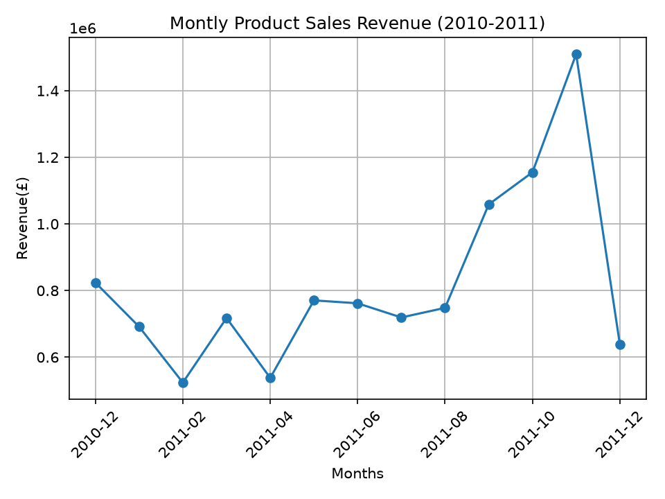
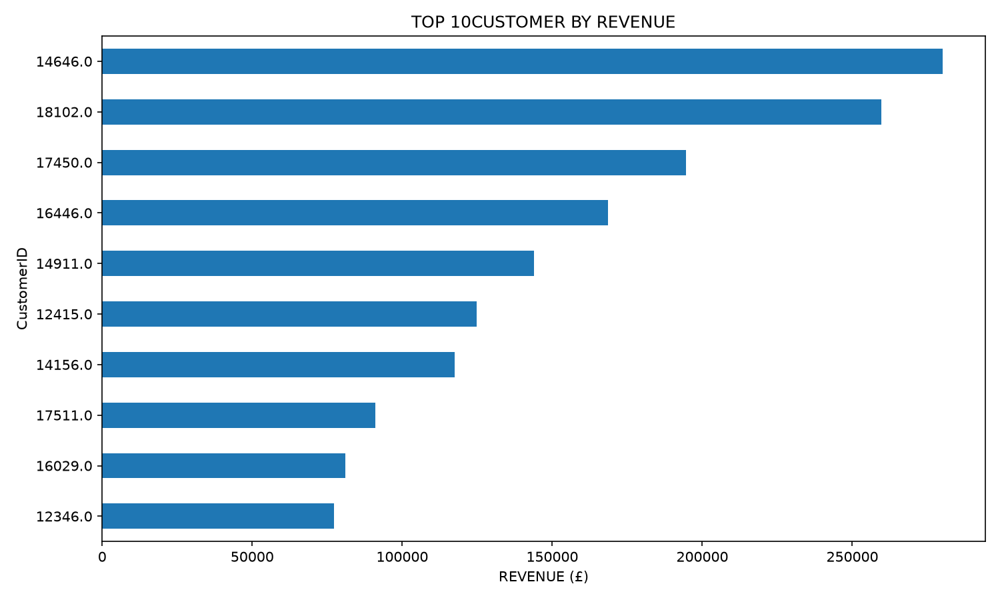

# E-commerce Sales Analytics

A Python-based analysis of retail transactions to uncover sales trends, identify high-value customers, and understand customer purchasing behaviour.

**Tech Stack:** Python · Pandas · NumPy · Matplotlib

## Key Insights

### Monthly Sales Trends

- November 2011 recorded the highest monthly revenue at **£1.51M**.
- From October to November, revenue increased by **30.69%**, while unique invoices increased by **35.74%**.
- The increase suggests higher transaction activity contributed to the revenue peak.



### Customer Analysis

- Analysed **4,338 identified customers** using revenue, purchase frequency, and recency.
- The top 10 customers contributed **17.26%** of identified-customer revenue.
- The top 50 customers contributed **33.23%**.



### RFM Customer Segmentation

RFM scoring was used to group customers by purchase recency, invoice frequency, and historical spending.

| Segment | Customers | Revenue Share |
|---|---:|---:|
| Champions | 946 | 64.63% |
| Loyal Customers | 789 | 15.46% |
| Other | 1,689 | 12.01% |
| At Risk | 373 | 4.14% |
| Need Attention | 541 | 3.75% |

**Key takeaway:** Champions represented 21.81% of identified customers but generated 64.63% of their revenue, making customer retention an important area for further investigation.

## Tools & Techniques

- Data cleaning and missing-value analysis
- Exploratory data analysis (EDA)
- Revenue and invoice aggregation
- Customer-level analysis
- RFM scoring and rule-based segmentation
- Data visualization

## Dataset

[UCI Online Retail Dataset](https://archive.ics.uci.edu/dataset/352/online+retail) — historical retail transactions from December 2010 to December 2011.

## Run Locally

The project uses Python and the dependencies listed in `requirements.txt`. The original dataset must be placed in `data/online_retail.xlsx`.

```bash
pip install -r requirements.txt
python src/analysis.py
```

## Limitations

- Customer-level analysis excludes transactions without an identifiable customer ID.
- Revenue is calculated using project-specific transaction filters and is not audited accounting revenue.
- RFM segments depend on the scoring and classification rules; findings describe historical behaviour and do not guarantee future purchases.

## SQL Analysis Findings
1. United Kingdom dominates sales.

The UK generated approximately £9.01 million, making it the largest market by a substantial margin.

2. Netherlands and EIRE have interesting differences.

Netherlands generated slightly more revenue than EIRE despite having considerably fewer invoices. This suggests a higher average revenue per invoice.
- Netherlands: approximately £3,036.66 per invoice.
- EIRE: approximately £984.21 per invoice.
3. Market concentration is worth investigating.

The business appears heavily dependent on UK sales. Further analysis could investigate international expansion opportunities and customer purchasing patterns.


